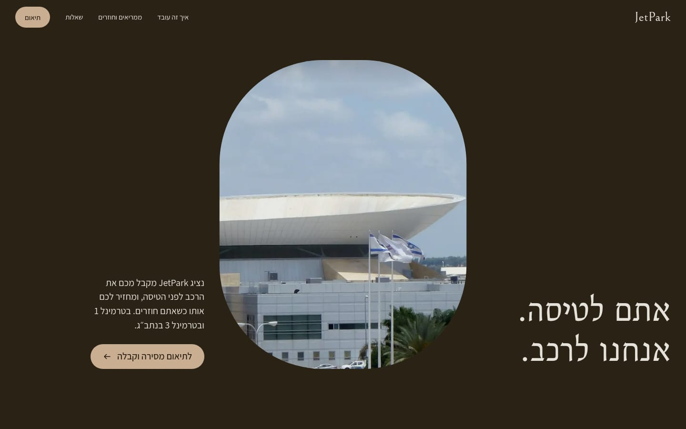
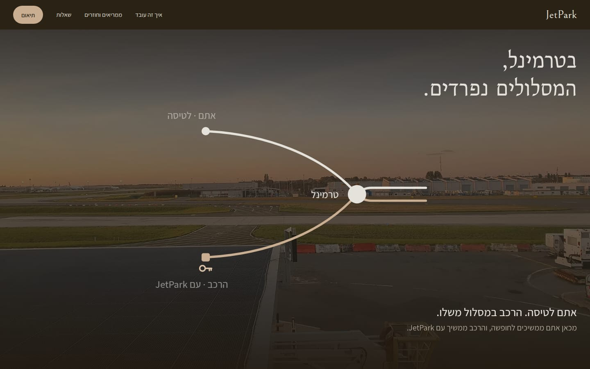
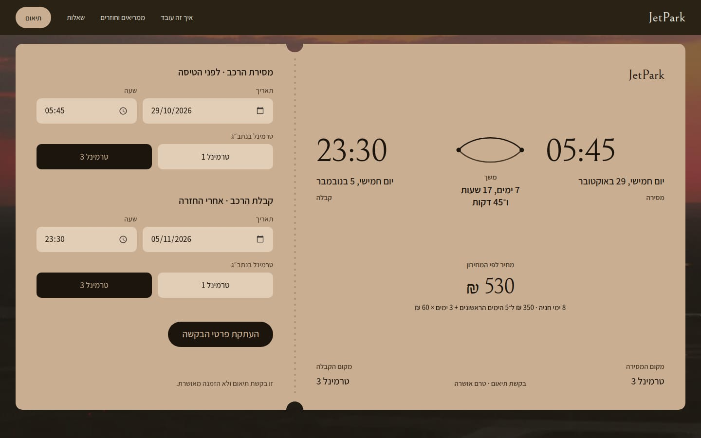
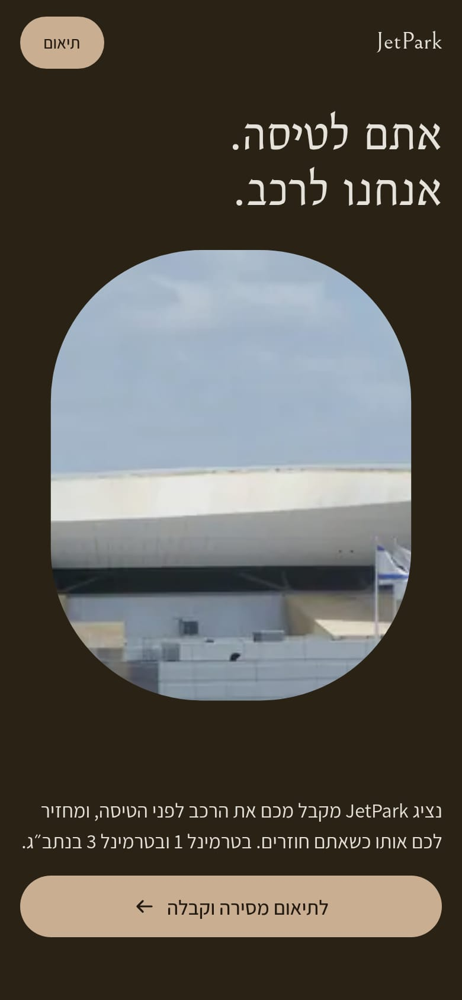

# JetPark

A Hebrew, right-to-left marketing site for an airport parking service built around one idea: a JetPark representative takes your car at the terminal before you fly and hands it back at the terminal when you land.

> **Demo project.** JetPark is a portfolio piece. The site is not connected to a live service: no booking is created, nothing is sent to a server, and the coordination card only produces text you can copy. Prices, terminals and copy are sample content.



## Concept

*The vacation starts at the terminal. We carry on with the car.*

The whole page is drawn from one motif, **the lens**: two arcs between two points. The upper arc is the traveller's trip, the lower arc is the car's path, and the two points are the two meetings at the terminal. The motif appears in the handoff scene, the four-station route, the departing/returning switch and the coordination card.

## Features

- **Opening window.** The first screen shows Terminal 3 at Ben Gurion Airport through an aircraft-window opening that widens to full bleed as you scroll. No loader, no intro.
- **Key handoff scene.** A pinned, scroll-driven SVG scene. Two strands (you and the car) arrive together, the key passes from the traveller to the car at the terminal, and the paths part.
- **Four-station route.** A sticky lens drawing that fills in as you move through the stations: coordinate, hand over at the terminal, vacation, pick up at the terminal. Mobile gets its own stacked sequence that never blocks touch scrolling.
- **Departing / returning switch.** An accessible tablist (arrow keys, Home and End) that changes photo, composition and copy with a clip-path transition.
- **Boarding-pass coordination card.**
  - Pick the handover and return date, time and terminal (1 or 3).
  - Live summary of both meetings, the exact duration, and a price calculated from the price list.
  - Validation: a handover time in the past is rejected, and the return must come after the handover.
  - One-click copy of the request, with a manual fallback. WhatsApp, email and phone actions appear only once contact details are configured.
  - The card states clearly that it is a coordination request, not a confirmed booking.
- **Price calculator.** Up to 5 days for 350 ₪, then 60 ₪ for each additional day. Every started 24 hours counts as a day.
- **Accessibility.** Semantic RTL markup, a skip link, visible focus states, keyboard support throughout, live regions for the card summary and errors, and `prefers-reduced-motion` support (every scene shows its finished state, still). No information is hover-only.
- **Motion system.** No animation library. A small `requestAnimationFrame` scroll-progress hook writes styles directly, so there are no React re-renders per frame. Everything else is CSS transitions, keyframes and SVG line drawing, animating only transform, opacity, clip-path and stroke offsets. All easing comes from one set of tokens.

| Handoff scene | Coordination card | Mobile |
| --- | --- | --- |
|  |  |  |

## Tech stack

- [Next.js 15](https://nextjs.org) (App Router, statically prerendered)
- React 19 and TypeScript
- Tailwind CSS v4, with the design tokens in `src/app/globals.css`
- `next/font` (Bellefair and Assistant, Hebrew subsets) and `next/image`
- ESLint (`eslint-config-next`)

## Getting started

Requires Node.js 18.18 or later.

```bash
npm install
npm run dev          # http://localhost:3000
```

Production build:

```bash
npm run build
npm start
```

Checks:

```bash
npm run lint
npm run typecheck
```

## Configuration

| File | What it holds |
| --- | --- |
| `src/config/site.ts` | Site URL and contact channels (phone, WhatsApp, email). Empty values are not rendered. |
| `src/config/pricing.ts` | Price list: included days, base price, price per additional day. |
| `src/lib/photos.ts` | Every image used on the page, with alt text and credit. |

## Project structure

```
src/
  app/          layout, page, global styles and design tokens
  components/   one component per section (Hero, Handoff, Route, Modes, Booking, Questions, Footer)
  config/       site and pricing settings
  lib/          scheduling and validation, pricing, scroll-motion hooks, photo registry
public/
  photos/       licensed photographs, credits.json and CREDITS.md
  video/        licensed cloud loop and its credits
```

## Image and video credits

All imagery is atmosphere only. None of it shows JetPark staff, vehicles or facilities. Credits are also shown in the site footer and listed in [`public/photos/CREDITS.md`](public/photos/CREDITS.md).

| File | Title | Creator | Licence | Source |
| --- | --- | --- | --- | --- |
| `public/photos/hero-terminal-3.jpg` | Israel Ben Gurion Airport terminal 3 closeup | Djampa | [CC BY-SA 4.0](https://creativecommons.org/licenses/by-sa/4.0) | [Wikimedia Commons](https://commons.wikimedia.org/wiki/File:Israel_Ben_Gurion_Airport_terminal_3_closeup.jpg) |
| `public/photos/apron-dusk.jpg` | CDG airport terminal 2 at dusk 10 | Syced | [CC0](https://creativecommons.org/publicdomain/zero/1.0/deed.en) | [Wikimedia Commons](https://commons.wikimedia.org/wiki/File:CDG_airport_terminal_2_at_dusk_10.jpg) |
| `public/photos/jetbridge-dusk.jpg` | CDG airport terminal 2 at dusk 5 | Syced | [CC0](https://creativecommons.org/publicdomain/zero/1.0/deed.en) | [Wikimedia Commons](https://commons.wikimedia.org/wiki/File:CDG_airport_terminal_2_at_dusk_5.jpg) |
| `public/photos/jetbridge-sun.jpg` | CDG airport terminal 2 at dusk 6 | Syced | [CC0](https://creativecommons.org/publicdomain/zero/1.0/deed.en) | [Wikimedia Commons](https://commons.wikimedia.org/wiki/File:CDG_airport_terminal_2_at_dusk_6.jpg) |
| `public/photos/road-light-trails.jpg` | Highway light trains at night (Unsplash) | Jamie Street | [CC0](https://creativecommons.org/publicdomain/zero/1.0/deed.en) | [Wikimedia Commons](https://commons.wikimedia.org/wiki/File:Highway_light_trains_at_night_(Unsplash).jpg) |
| `public/photos/wing-takeoff.jpg` | Milan Takeoff during Covid19 | Ekin Saygi Tsantis | [CC BY-SA 4.0](https://creativecommons.org/licenses/by-sa/4.0) | [Wikimedia Commons](https://commons.wikimedia.org/wiki/File:Milan_Takeoff_during_Covid19.jpg) |
| `public/photos/wing-landing.jpg` | Evening mood shortly before landing at Munich Airport on the flight from Dresden | Thomas Woodtli | [CC BY 2.0](https://creativecommons.org/licenses/by/2.0) | [Wikimedia Commons](https://commons.wikimedia.org/wiki/File:Evening_mood_shortly_before_landing_at_Munich_Airport_on_the_flight_from_Dresden_(8500484091).jpg) |
| `public/photos/sky-takeoff.jpg` | Rosy Sunset for Takeoff at Detroit | formulanone | [CC BY-SA 2.0](https://creativecommons.org/licenses/by-sa/2.0) | [Wikimedia Commons](https://commons.wikimedia.org/wiki/File:Rosy_Sunset_for_Takeoff_at_Detroit_(49173577872).jpg) |
| `public/photos/highway-blue-hour.jpg` | Light Trails On The Highway | Makia Minich | [CC BY-SA 3.0](https://creativecommons.org/licenses/by-sa/3.0) | [Wikimedia Commons](https://commons.wikimedia.org/wiki/File:Light_Trails_On_The_Highway_(60829112).jpeg) |
| `public/photos/coast-dusk.jpg` | Lifeguard chair at dusk | Fré Sonneveld | [Unsplash License](https://unsplash.com/license) | [Unsplash](https://unsplash.com/photos/2qLT_Rq-2tk) |
| `public/photos/coast-rock.jpg` | Rock in a calm sea | Stephen Radford | [Unsplash License](https://unsplash.com/license) | [Unsplash](https://unsplash.com/photos/674bDNKmnIk) |
| `public/video/clouds-window.webm` | Clouds from Airplane Window 1 2016-08-29 | F ASTILY | [CC BY-SA 4.0](https://creativecommons.org/licenses/by-sa/4.0) | [Wikimedia Commons](https://commons.wikimedia.org/wiki/File:Clouds_from_Airplane_Window_1_2016-08-29.webm) |

Share-alike (CC BY-SA) files were resized only. Any altered version of them must be shared under the same licence. The screenshots in `docs/` contain these images and carry the same credits.

## License

The images and video keep the licences listed above. No licence is granted for the source code unless a `LICENSE` file is added to this repository.
